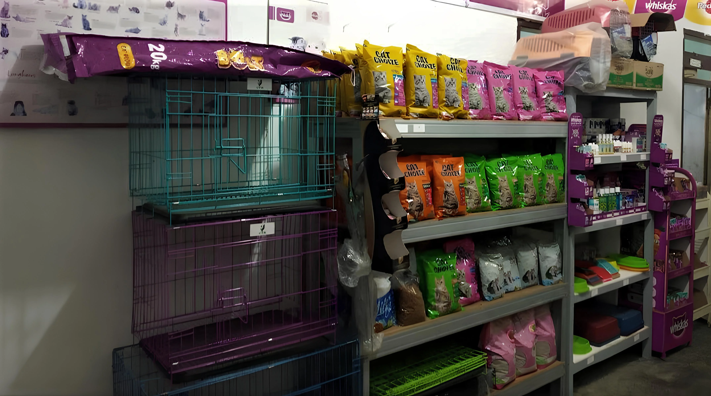
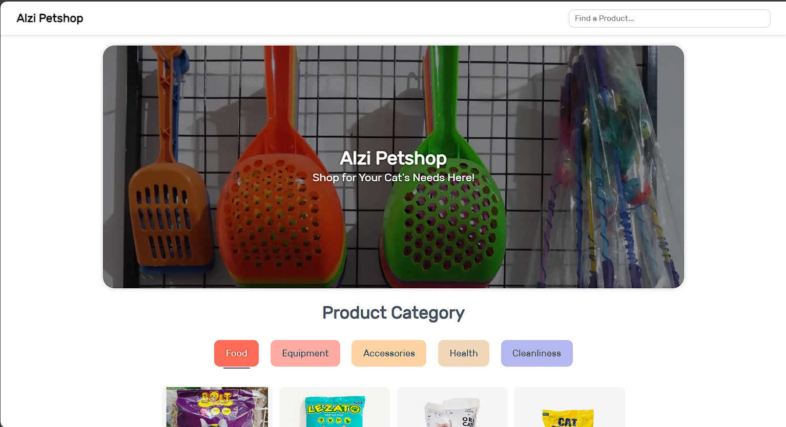
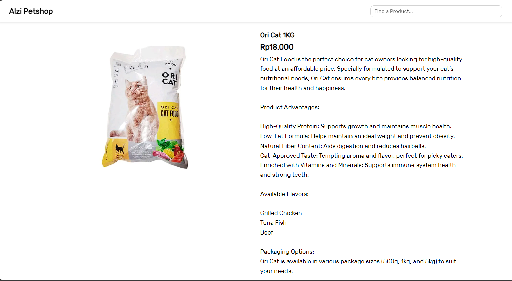

<div align="center">



# Alzi Petshop - E-Commerce & Inventory Management System

A web-based e-commerce and stock management application designed for pet shop operations. Built with native PHP and MySQL, supporting multi-role access (Buyer, Seller, Admin), interactive shopping cart, stock management, and online payment via Midtrans Payment Gateway.

<p align="center">
  
  
  
  
</p>

</div>

---

## ✨ Main Features

- [x] **Product & Inventory Management (Full CRUD):**
  - Sellers can add, update, delete, and monitor product stock with real-time "Out of Stock" status.
  - Automatic image conversion to `.webp` format using PHP GD library.
- [x] **Multi-Role Authentication System:**
  - **Buyer:** Browse catalog, view product details, add items to cart, and checkout.
  - **Seller:** Dedicated dashboard (`index_p.php`) to manage products, prices, and stock levels.
  - **Admin:** Administrative dashboard (`index_a.php`, `admin/`) for user and catalog oversight.
- [x] **Shopping Cart & Checkout:**
  - Dynamic shopping cart with quantity adjustment and order total calculation.
- [x] **Payment Gateway Integration:**
  - Integrated with **Midtrans Snap API** for secure digital transactions.
  - Webhook notification handler for real-time order status updates.
- [x] **Third-Party Integrations:**
  - **Google Maps:** Embedded shop location for customer navigation.
  - **WhatsApp API:** Direct contact button for customer inquiries.
- [x] **Responsive UI:** Built with Bootstrap 5 and custom CSS for seamless desktop and mobile access.

---

## 🛠️ Technologies Used

<div align="center">
  
  
  
  
  
</div>

---

## 🚀 Installation & Local Setup

### **1. Prerequisites**
- Local Web Server: [XAMPP](https://www.apachefriends.org/) (PHP 7.4 or 8.x + MySQL + Apache)
- Web Browser: Google Chrome, Firefox, or Edge

### **2. Setup Steps**
1. **Clone the Repository:**
   ```bash
   git clone https://github.com/rangga-ayi/E-Commerce-UAS.git
   ```
2. **Move to Server Directory:**
   Move the cloned folder into your XAMPP `htdocs` directory (e.g. `C:/xampp/htdocs/alzipetshop`).
3. **Database Configuration:**
   - Open phpMyAdmin (`http://localhost/phpmyadmin`).
   - Create a new database named `alzipetshop`.
   - Import the `alzipetshop.sql` file located in the root directory.
4. **PHP GD Extension Setup:**
   - Open `php.ini` from XAMPP Control Panel.
   - Ensure `extension=gd` is enabled (remove leading semicolon `;` if present).
   - Restart Apache.
5. **Run the Application:**
   - Navigate to `http://localhost/alzipetshop/` in your browser.

---

## 📸 Application Preview

<details open>
<summary><b>Click to toggle preview screenshots</b></summary>
<br>

| Product Catalog (Buyer View) | Product Details & Inquiry |
| :---: | :---: |
|  |  |

</details>

---

## 📁 Project Structure

```
.
├── admin/                  # Admin dashboard & management scripts
├── css/                    # Custom CSS & Bootstrap stylesheets
├── font/                   # Web typography assets
├── imgs/                   # Product images, slides, and map markers
├── js/                     # Client-side JavaScript libraries
├── login/                  # Authentication forms & session handlers
├── midtrans-php/           # Midtrans PHP SDK library
├── php/                    # Backend business logic & shared components
├── preview/                # Documentation screenshot previews
├── script/                 # Page-specific scripts
├── alzipetshop.sql         # Database schema and initial records
├── checkout.php            # Transaction checkout logic
├── index.php               # Buyer storefront & catalog view
├── index_a.php             # Admin entry point
├── index_p.php             # Seller dashboard & inventory view
├── keranjang.php           # Shopping cart interface
├── midtrans_config.php     # Payment gateway configuration
├── notification_handler.php# Webhook endpoint for payment status
├── produk.php              # Product detail & direct contact
├── tambah.php              # Product registration form
├── edit.php                # Product modification form
└── README.md               # Project documentation
```

---

## 👥 Contributors

* **Rangga Ayi Pratama** ([@rangga-ayi](https://github.com/rangga-ayi))
* **Aditiya Alif As Siddiq** ([@aditiya-alif](https://github.com/aditiya-alif))

---

## ⚖️ License

Distributed under the MIT License. See [LICENSE](LICENSE) for details.
